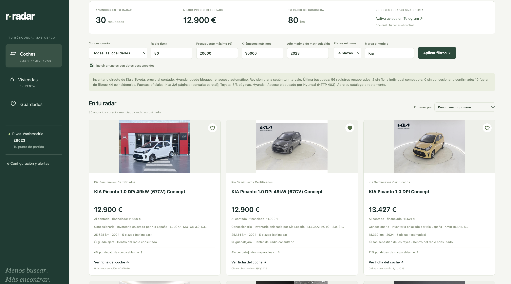
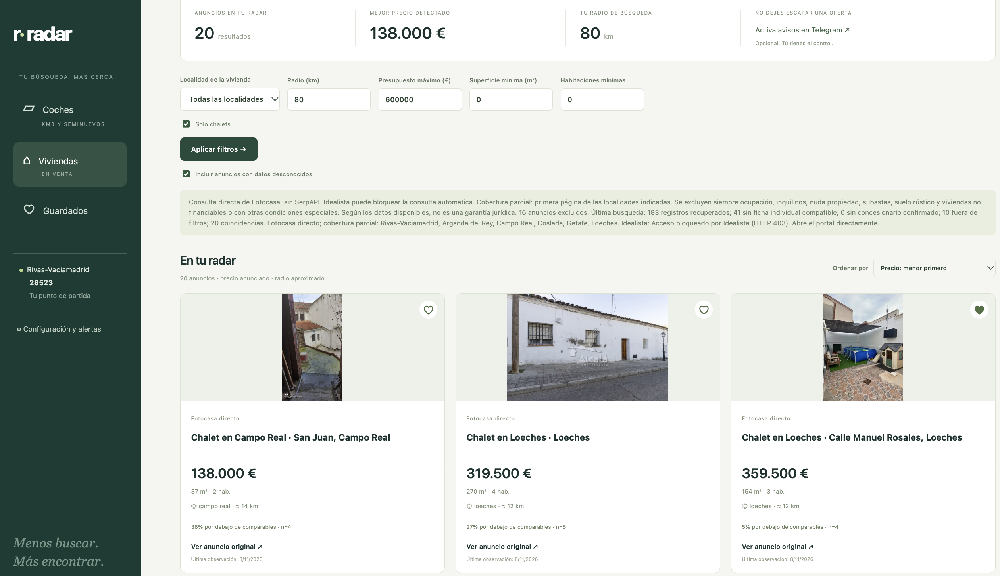
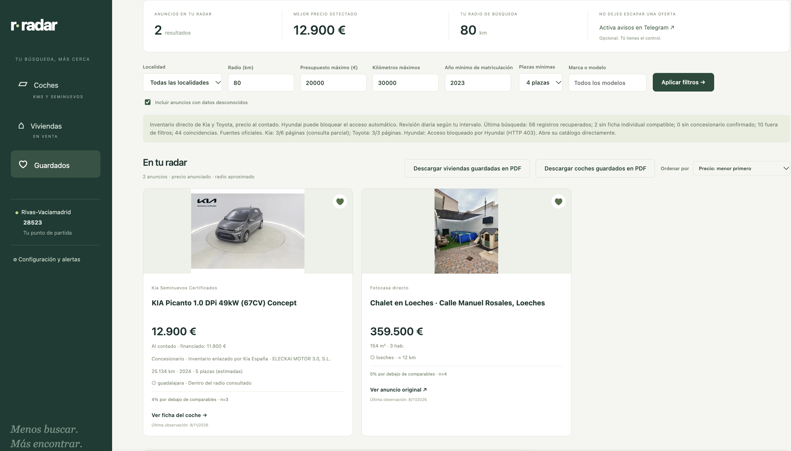

# Radar local

Busca coches de concesionarios y viviendas en venta cerca de tu código postal. Guarda los anuncios que te interesen y descarga sus fichas en PDF, con fotos cuando estén disponibles.

Funciona en tu ordenador, con una interfaz en español. Las búsquedas directas no requieren cuenta ni proveedor de pago.

## 1. Instalar y abrir

Necesitas conexión a Internet y **Node.js 24 o posterior**. Puedes instalarlo desde [la web oficial de Node.js](https://nodejs.org/es/download).

1. Descarga o recibe la carpeta completa de la aplicación y descomprímela.
2. Abre una terminal dentro de esa carpeta. Si la abres en otra ubicación, entra primero con `cd "/ruta/a/la/carpeta"`, sustituyendo la ruta por la tuya.
3. Comprueba la versión de Node y arranca Radar:

   ```sh
   node --version
   npm start
   ```

4. Abre [http://127.0.0.1:8081](http://127.0.0.1:8081) en tu navegador.

No hace falta ejecutar `npm install`: el proyecto no tiene dependencias adicionales de Node.

Mantén la terminal abierta mientras uses Radar. Para detenerlo, pulsa **Ctrl+C** en esa terminal. Para volver a abrirlo, ejecuta otra vez `npm start`: tus preferencias y favoritos se conservan.

## 2. Hacer tu primera búsqueda

1. Selecciona **Coches** o **Viviendas** en el menú.
2. Introduce tu **código postal español** en el recuadro de arriba y ajusta el radio y el presupuesto.
3. Pulsa **↻ Actualizar**. El botón guarda tus filtros y consulta anuncios de la categoría seleccionada.

Puedes cambiar de código postal en cualquier momento. Si no se puede resolver su ubicación, Radar conserva la configuración anterior y muestra un mensaje.

**Aplicar filtros** guarda los cambios y filtra los anuncios ya recuperados. Para consultar anuncios nuevos en los portales, pulsa **Actualizar**.

## 3. Ajustar lo que buscas

| Filtro | Cómo funciona |
| --- | --- |
| Código postal y radio | Establecen la zona de búsqueda. Las distancias son aproximadas. |
| Presupuesto máximo | Limita el precio anunciado. En coches se utiliza el precio al contado cuando se publica. |
| Concesionario | Filtra por la **localidad del concesionario**, no por su nombre comercial. |
| Kilómetros y año mínimo | Limitan el kilometraje y el año de matriculación de los coches. |
| Plazas mínimas | Elegir **4** incluye coches de **4, 5, 7 o más plazas**. «Todas» elimina ese mínimo. |
| Superficie y habitaciones | Establecen mínimos para las viviendas. |
| Solo chalets | Marcado: muestra únicamente chalets. Desmarcado: incluye pisos y otros tipos de vivienda. |
| Incluir datos desconocidos | Permite anuncios que no publican algunos datos necesarios para los filtros. |

Si un coche no publica un número válido de plazas, se asumen **5 para el filtro** y se indican como **«5 plazas (estimadas)»**. Comprueba el dato en el anuncio antes de decidir. Las plazas confirmadas siempre se respetan.

Las capturas muestran ejemplos de uso. Los filtros y anuncios variarán según tu código postal y la fecha de consulta.



*Filtros de coches y anuncios recuperados de los concesionarios.*

Las fotos proceden del anuncio original. Si no hay una imagen compatible o el portal no permite descargarla, la tarjeta conserva su imagen de sustitución. Para cargar las fotos de anuncios recuperados antes de activar esta función, pulsa **Actualizar** en Viviendas.



*La búsqueda de viviendas permite activar o desactivar «Solo chalets».*

## 4. Guardar y descargar fichas

Pulsa el **corazón** de una tarjeta para añadirla a **Guardados**. Vuelve a pulsarlo para quitarla.

En Guardados puedes descargar por separado:

- **Coches guardados en PDF**: fotos disponibles, precio, kilómetros, matriculación, plazas, concesionario y enlace original.
- **Viviendas guardadas en PDF**: fotos disponibles, precio, superficie, habitaciones, localidad y enlace original.

La descarga incluye los anuncios guardados de ese tipo en la zona actual, aunque algunos estén ocultos por los filtros. Una foto ausente no impide crear el PDF: se indica que no está disponible.



*Los favoritos reúnen las fichas y permiten descargar los PDF de coches y viviendas.*

## 5. Seguir novedades

Por defecto, Radar revisa las fuentes **una vez al día**. Puedes cambiar el intervalo en **Configuración y alertas**, entre 15 y 1.440 minutos. **Actualizar** permite hacer una revisión manual de Coches o Viviendas sin esperar.

El seguimiento automático requiere que el servidor siga abierto en la terminal y que el ordenador esté encendido, activo y conectado a Internet. Cerrar la pestaña del navegador no detiene el servidor; cerrar su terminal sí lo detiene.

### Telegram, opcional

Para recibir avisos, crea un bot con **@BotFather**, inicia una conversación con él y añade su token y tu chat ID en Configuración y alertas. Activa los avisos, guarda la configuración y pulsa **Enviar prueba** si quieres comprobarla.

La primera búsqueda establece una referencia sin enviar anuncios antiguos. Las siguientes pueden avisar de anuncios nuevos y bajadas de precio que cumplan tus filtros. Los envíos fallidos se reintentan; un fallo de conexión puede ocasionar algún aviso duplicado.

## Si algo no aparece

- **No hay resultados:** amplía el radio o presupuesto, revisa los mínimos y pulsa Actualizar. Los anuncios sin datos suficientes se excluyen por defecto.
- **Una fuente está bloqueada o falla:** consulta el aviso de estado. Radar conserva las observaciones anteriores; puedes abrir el portal original para comprobarlas.
- **No se localiza el código postal:** comprueba que tiene cinco cifras y conexión a Internet. Un código válido puede faltar en un proveedor; Radar prueba una fuente alternativa.
- **Una foto no se ve:** pulsa Actualizar en esa categoría y recarga la página. Algunas fichas antiguas o retiradas pueden seguir sin foto.
- **Después de actualizar los archivos de la app:** detén el servidor con Ctrl+C, vuelve a ejecutar `npm start` y recarga el navegador.

Si macOS muestra un error al leer la configuración OpenSSL del sistema, este arranque alternativo evita leer ese archivo sin cambiar la configuración del equipo:

```sh
node --openssl-config=/dev/null server.mjs
```

## Fuentes y límites

Los coches se consultan directamente en **Kia y Toyota**. Kia limita la consulta a tres páginas y abre su catálogo por referencia; Toyota recorre las páginas disponibles e informa si la consulta queda incompleta. Hyundai puede bloquear el acceso automático y ofrece un enlace a su catálogo.

Las viviendas se consultan directamente en **Fotocasa**: la primera página de la localidad elegida y hasta cinco zonas cercanas enlazadas por el portal. Idealista puede bloquear las consultas automáticas. La cobertura es parcial: Radar no garantiza recuperar todos los anuncios dentro del radio.

**SerpAPI** es una alternativa opcional para viviendas, seleccionable en Configuración. Requiere una clave y consume cuota; **no se necesita para las búsquedas directas predeterminadas**. Sus resultados proceden de un índice y pueden estar desactualizados.

Las distancias se estiman con coordenadas de códigos postales, municipios o concesionarios; no representan un trayecto desde tu dirección. Para localizar un código se consulta Zippopotam.us y, si hace falta, Photon/OpenStreetMap.

Se excluyen viviendas cuando los datos disponibles indican ocupación, inquilinos, nuda propiedad o usufructo, subasta, cesión de derechos, suelo rústico o no urbanizable, irregularidad urbanística, imposibilidad de visita o financiación no disponible. El filtro de datos desconocidos no elimina estas exclusiones. Una condición omitida por el anunciante puede no detectarse.

Cuando una ficha individual de coche devuelve una retirada definitiva o indica expresamente que ya no está disponible, se considera vendido: desaparece de Coches y se conserva señalado en Guardados. Las comprobaciones se hacen por tandas. Un bloqueo, un fallo temporal o la ausencia en una búsqueda parcial no significa vendido. Kia no facilita una ficha individual consultable para confirmar su disponibilidad por esta vía.

Confirma siempre en el anuncio original la disponibilidad, el precio al contado, la financiación, los gastos y la situación del inmueble. Las comparaciones requieren al menos tres anuncios similares observados: son comparaciones de precios publicados, no tasaciones.


Para comprobar el código durante el desarrollo:

```sh
npm test
```
